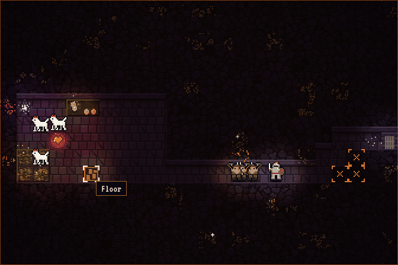
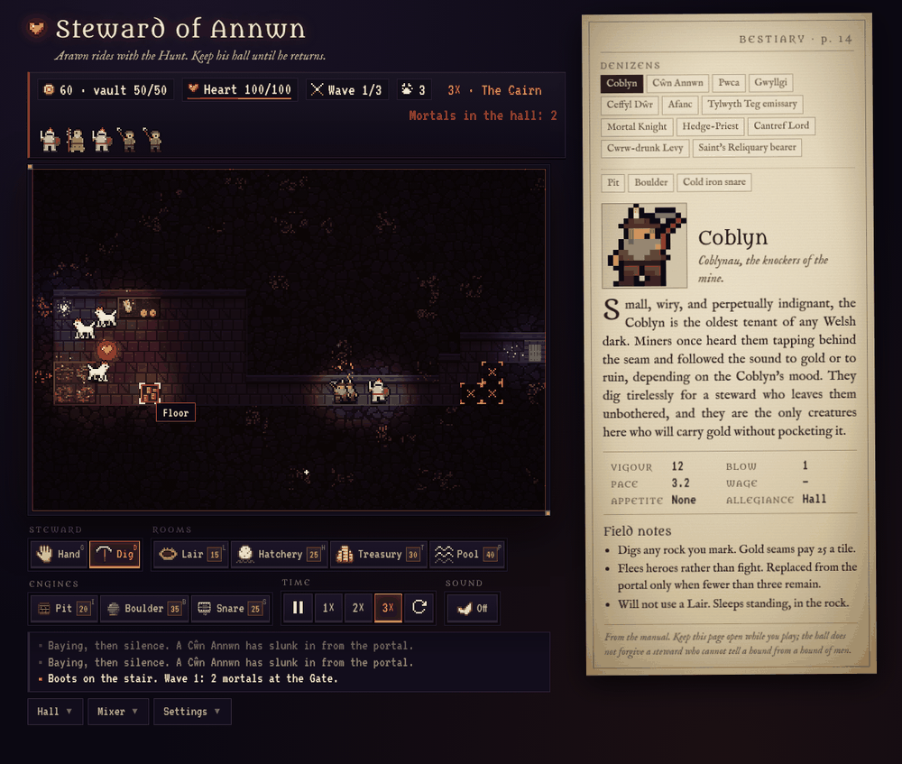
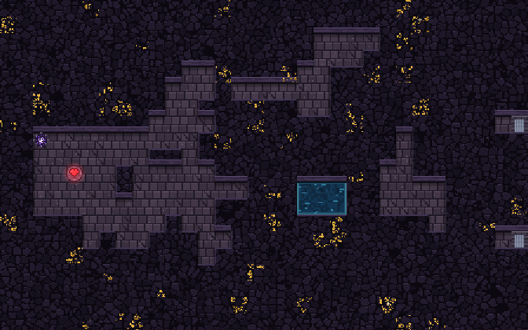
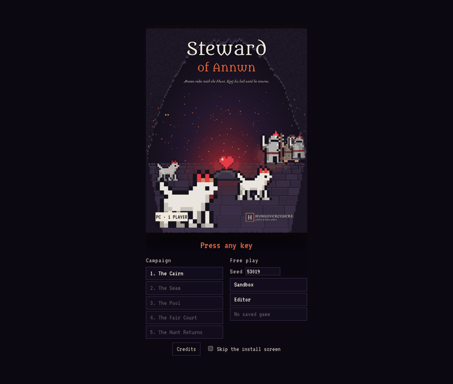

# Steward of Annwn

A Dungeon Keeper-style game in Welsh myth. Arawn, lord of Annwn, rides with the Wild Hunt and has left you the keys to his underground hall. Mortals have heard he is gone and come down the stair to strike the Heart. Keep it beating through a five-level campaign, from the Cairn to the night the Hunt returns.

Vite + TypeScript, plain Canvas 2D, no engine, no runtime dependencies. One static page, with a Tauri wrapper for the desktop.

## Screenshots

| The hall in play | The whole page |
| --- | --- |
|  |  |

| The art, unlit (editor view) | The title | The sprite sheet |
| --- | --- | --- |
|  |  |  |

## Running it

Needs [mise](https://mise.jdx.dev) (or node 22 + [go-task](https://taskfile.dev) installed by hand).

```sh
mise install        # node + task, pinned in .mise.toml
task dev            # serve with hot reload
task check          # lint + test + bench + build (what CI runs)
task sprites        # re-render art/figures.json into public/sprites.png
task manual         # dist/manual.pdf and dist/reference-card.pdf from the game data
task box            # box front/back/spine, 3D mock and the title art (docs/box)
task desktop        # Tauri bundle for this platform (see docs/desktop.md)
task release        # zip the web build and push to itch.io with butler
task --list         # everything else
```

Open `?start=cairn` (or any level id) to skip the title screen, and
`?theme=contrast` or `?theme=hunt` to force a theme.

The **style guide** is at [`/styleguide.html`](styleguide.html) (served by
`task dev`, built by `task build`): every token, type size, button state,
the HUD, log and manual, every icon, figure, tile and engine, and a lit
scene, drawn with the game's own code. `docs/design.md` explains the system.

## Controls

| Action | How |
| --- | --- |
| Pick a tool | Toolbar buttons, or keys `G` Hand · `D` Dig · `L` Lair · `H` Hatchery · `T` Treasury · `P` Pool · `I` Pit · `B` Boulder · `S` Snare |
| Mark rock for digging | Dig tool: click or drag across rock. Right-click, or click a marked tile, to unmark. |
| Build a room | Room tool: click or drag on floor. Lair 15g, Hatchery 25g, Treasury 30g, Pool 40g. Rooms are contiguous regions; bigger is better. |
| Sell a room | Right-click it, or click it again with the same tool. Half back. |
| Lay a trap | Pit, Boulder or Snare on floor; a Coblyn builds it. Click again to cancel. |
| Pick up a creature | Hand tool: click it (opens its page), then click a tile to send it there. |
| Read about a creature | Dig or Hand tool: click it. Or use the tabs on the manual page. |
| Pause, speed, restart | `Space`, `1` `2` `3`, `R` (asks first). You can still plan while paused. |
| Keyboard-only | Focus the board: arrows move a cursor, `Enter` uses the tool, `Backspace` is the right-click. |
| Save and load | Save / Load use the browser; Export / Import use a file. |
| Fullscreen, timings | `F11`, `F3`. Settings has text size, board scale, reduced motion, steady torches and colour-blind safe bars. |
| Sound | The "Sound" button, then the Mixer. It must be a click; browsers insist. |

## How the hall works

- **Coblynau** dig what you mark. Gold seams leave a 25-gold pile that a Coblyn carries to a Treasury with room; gold on the floor is not yours, and a mortal who walks over it pockets it. They build traps, flee heroes, and are replaced from the Portal while fewer than three remain.
- **Denizens** arrive through the Portal every 7 seconds if the rooms are right (and the level allows them): **Cŵn Annwn** (Lair 4, Hatchery 2), **Pwca** (Lair 2, Treasury 2), **Gwyllgi** (Lair 6, Treasury 3), **Ceffyl Dŵr** (Pool 3, Lair 4), **Afanc** (Lair 9, Treasury 4, 300 gold), and the **Tylwyth Teg emissary** when the vault holds 150, with terms. Room sizes are the largest contiguous region. They eat, sleep, squabble with creatures they dislike, draw wages on payday, and rush mortals. Starve or stiff them and they leave.
- **Mortals** come through the Gates on the level's schedule: knights, priests who heal, the Cantref Lord who hunts your strongest creature, levies who break when the first dies, and the reliquary bearer near whom nothing of yours will fight. They have nerve; lose it and they run for the Gate. They tunnel through rock at a quarter speed if you give them no corridor.
- **Engines**: a pit, a boulder for a straight corridor, a cold iron snare. One use each.
- **Win** by clearing the schedule, or on the last level by holding until the Hunt returns. **Lose** when the Heart's 100 points reach zero.

## Layout

```
src/sim/      pure game logic, no DOM, covered by Vitest (incl. a scripted steward, save/load, sandbox)
src/render/   canvas drawing, sprite sheet + rectangle fallback (drawBeast), autotiles, coloured light map
src/ui/       title, briefing, HUD, toolbar, log, manual panel, overlay, editor, settings, audio and mixer
src/design/   tokens (every colour, size and font), themes, contrast and colour-vision checks
src/styles/   the stylesheet in @layers; tokens.css is generated from src/design
src/data/     bestiary.ts (every creature, engine and trade), waves.ts, levels.ts (the campaign), rooms.ts
art/          figures.json (creatures), pixels.json (every other pixel map), fonts/ (OFL);
              scripts/ renders the sheet, the manual, the box, the release
src-tauri/    the desktop wrapper
docs/         design (the design system), backlog, balance, performance, desktop, itch page, box art, devlog
src/main.ts   wiring and the game loop
src/styleguide.ts  the living style guide (styleguide.html)
```

Tests run against `src/sim` (with a coverage gate of 80%), the design
system in `src/design` (tokens, contrast, fonts, art data) and board scaling, and a
pathfinding budget enforced by `task bench`. `docs/balance.md` records the
tuning passes; `src/sim/balance.test.ts` fails the build if the scripted
steward survives fewer than 60% of seeds.

## Sound

The Sound button starts three detuned drones and the roof drips; the Mixer
below the toolbar has master, ambient and effects sliders. Hounds bay when
they take up a chase, quieter the closer they are; picks ring on stone;
the Heart tolls when struck; mortal footsteps are louder in open halls.

## Status

The backlog in `docs/backlog.md` (milestones M0–M7, tracked as GitHub
issues) is implemented. What could not be done from a build container is
noted in the docs: desktop bundles need the platform toolchains in
`docs/desktop.md`, the itch.io upload needs butler and credentials, and the
sprite sheet is generated from `art/figures.json` rather than drawn by hand.

## Next

- Hand-drawn sprites and tiles in the same sheet layout.
- Tile-layer caching if the F3 overlay shows tiles over budget on your machine.
- A grace period after a cleared wave, per `docs/balance.md`.
- Playtesting by humans, which no bot replaces.
