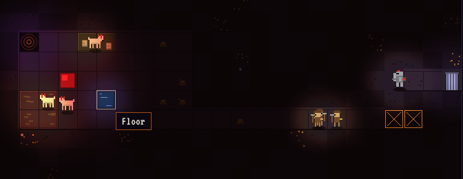
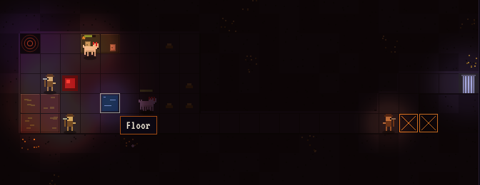

I have been building a small Dungeon Keeper-alike called *Steward of Annwn*: a 24 by 16 grid of Welsh rock, a Heart to defend, hounds with red ears, and a manual you are supposed to keep open while you play. It is plain Canvas 2D, no engine, one static page. This is the first of three posts about the parts of it that turned out to be interesting, and the first of those is the one that did more for the game's feel than anything else: the lighting.



## The problem with a dark game

Dungeon Keeper's hall is dark, and the darkness is the point. You dig a corridor and you cannot see the end of it. You see your creatures where they stand because they carry light with them. The Heart is a red fire in the middle. If you draw a dungeon fully lit it reads as a spreadsheet; drop it to a few lamps in a sea of black and it reads as a place.

The cheap way to get that on a canvas is the one I started with. Draw the scene as if the lights were on. Then cover the whole board with a dark layer and *cut holes in it*.

## Version one: cutting holes with `destination-out`

Canvas compositing has an operation called `destination-out`. Anything you draw while it is active removes what is already on the canvas instead of painting over it. Fill a layer with 86% black, switch to `destination-out`, and draw a radial gradient at each torch: the gradient punches a soft hole in the dark. Draw the dark layer on top of the scene and you have torchlight.

This is the whole pass from the first commit, trimmed of the light-collection code:

```ts
layer.fillStyle = `rgba(6, 3, 12, ${DARKNESS})`;          // 0.86
layer.fillRect(0, 0, w, h);
layer.globalCompositeOperation = 'destination-out';
for (const l of collectLights(g, entities)) {
  const flicker = 1 + 0.06 * Math.sin(t * 7.3 + l.phase) + 0.04 * Math.sin(t * 13.1 + l.phase * 1.7);
  const r = l.r * flicker;
  const grad = layer.createRadialGradient(l.x, l.y, 0, l.x, l.y, r);
  grad.addColorStop(0, 'rgba(0,0,0,1)');
  grad.addColorStop(0.45, 'rgba(0,0,0,0.85)');
  grad.addColorStop(1, 'rgba(0,0,0,0)');
  layer.fillStyle = grad;
  layer.fillRect(l.x - r, l.y - r, r * 2, r * 2);
}
layer.globalCompositeOperation = 'source-over';
ctx.drawImage(layer.canvas, 0, 0);
ctx.fillStyle = 'rgba(255, 122, 31, 0.035)';             // a faint ember wash
ctx.fillRect(0, 0, w, h);
```

Where the lights are is the part that makes it feel designed rather than generated. Not every lair tile gets a torch: every third one does, and every fourth Hatchery or Treasury tile, so rooms get a few pools of light rather than a flat glow. The Heart, the Portal and the Gate each get a big one. Every Coblyn and every mortal carries a lamp. The Pwca, which the manual says closes its eyes when it does not want to be seen, gets a lamp of radius 22 pixels, which is to say almost none.

The flicker is two sines at unrelated frequencies, 7.3 Hz and 13.1 Hz, with a per-light phase so the torches do not breathe in step. One sine looks like a metronome. Two look like fire. This is an old trick and it still works.

For a weekend this was the game's look, and it was most of the atmosphere. It had one real limitation: the holes are grey. The Heart is a red square, but the light it throws is the absence of darkness, which is no colour at all.

## Version two: a light map, multiplied

The replacement keeps the same shape (draw the scene, then darken it with a layer) but changes what the layer is. Instead of an opaque sheet with holes, it is a *light map*: a picture of how much light, and what colour of light, reaches each pixel. The map starts as a dim violet ambient. Each light is added into it with the `lighter` operation, which sums colours, so overlapping torches get brighter where they overlap. Then the map is drawn onto the scene with `multiply`, which scales each scene pixel by the light at that point.

```ts
map.globalCompositeOperation = 'source-over';
map.fillStyle = opts.hunt ? 'rgb(70, 84, 110)' : AMBIENT;   // rgb(36, 27, 48)
map.fillRect(0, 0, map.canvas.width, map.canvas.height);
map.globalCompositeOperation = 'lighter';
for (const l of collectLights(g, entities)) {
  const flicker = opts.reducedMotion
    ? 1
    : 1 + l.flicker * Math.sin(t * 7.3 + l.phase) + l.flicker * 0.7 * Math.sin(t * 13.1 + l.phase * 1.7);
  const r = l.r * 1.2 * flicker * k;
  const x = l.x * k;
  const y = l.y * k;
  const grad = map.createRadialGradient(x, y, 0, x, y, r);
  const color = opts.hunt ? 'rgba(230, 240, 255, 0.95)' : l.color;
  grad.addColorStop(0, color);
  grad.addColorStop(0.45, color.replace(/[\d.]+\)$/, '0.55)'));
  grad.addColorStop(1, 'rgba(0,0,0,0)');
  map.fillStyle = grad;
  map.fillRect(x - r, y - r, r * 2, r * 2);
}
ctx.save();
ctx.globalCompositeOperation = 'multiply';
ctx.imageSmoothingEnabled = true;
ctx.drawImage(map.canvas, 0, 0, w, h);
ctx.restore();
```

Now a light has a colour. The Heart is `rgba(255, 70, 70)` and the floor around it goes red. The Portal is violet, the torches orange, the Pools a cold `rgba(90, 170, 255)`, and the mortals carry something warm and yellowish so you can see them coming down a corridor before you can see them. The white hounds go pink when they sleep near the Heart, which I did not plan and have kept.

Two details matter for performance. The map is drawn at half resolution (`k = 0.5`, so 336 by 224 for the default board) and scaled up with smoothing on when it is multiplied in. Light is soft anyway; nobody can tell, and it quarters the gradient fill cost. And the flicker amplitude is now per light: torches shimmer at 0.06, the Heart at 0.04, the Gate at 0.02, and the Pools barely at all, because water does not flicker. Headless Chromium holds a steady 16.6 ms a frame with everything on, which is the vsync cap, so I stopped measuring.



## Two things I would not have thought of a year ago

The first is `prefers-reduced-motion`. Flicker is the kind of thing that is harmless to most people and genuinely unpleasant to some, and the media query costs one line to read:

```ts
const reduced = typeof matchMedia === 'function' && matchMedia('(prefers-reduced-motion: reduce)').matches;
```

With it set, every light holds steady. The scene is otherwise identical. The manual's page-turn animation and the blinking "Press any key" honour the same flag through CSS.

The second is that once the light map exists, it is a lever for the story. The last level of the campaign is called *The Hunt Returns*: you are not asked to win, only to hold the Heart for a little under five minutes until Arawn comes home with the Wild Hunt. When the clock runs out the sim sets a single boolean, `hunt`, and the renderer passes it through. Every light turns the same cold near-white and the ambient goes from violet to a steel blue. The horns sound in the log, every mortal's nerve breaks, and four hounds come through each Gate. All of that is sim work, except the one thing the player notices first, which is that the torches have gone white. That cost two ternaries.

## What I would tell past me

Draw the scene lit, then darken it. Do not try to light tiles as you draw them; you will end up with lighting logic in every sprite function. One dark layer on top is the right shape, and the only decision is whether the layer is a sheet with holes (fast to write, grey) or a multiplied light map (an afternoon more, and every light has a colour). If the game has a Heart, make it red.

Next time: why every creature's name, stats, flavour text, sprite and manual page come from one typed object, and what that bought.
