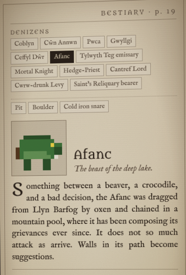
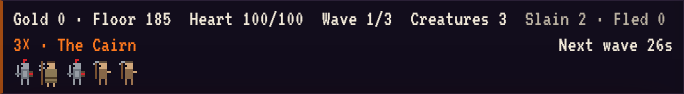
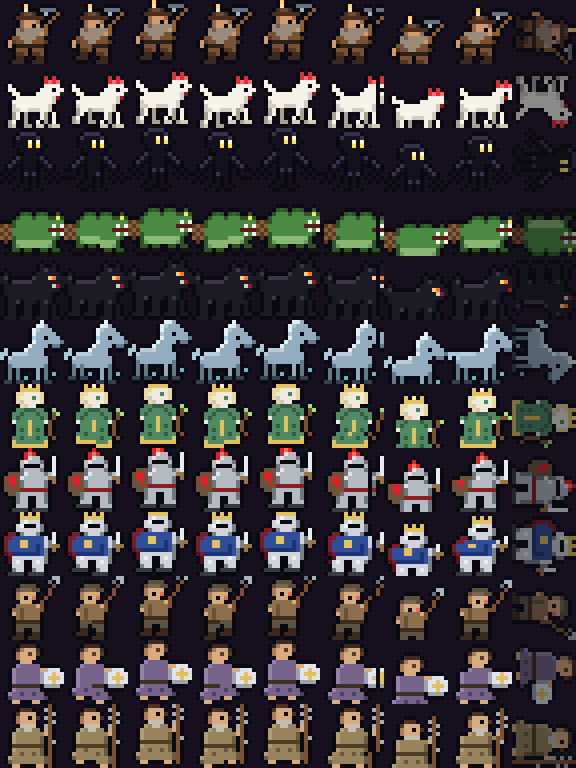

*Steward of Annwn* has twelve kinds of thing that walk: three Coblynau who dig, six denizens who fight or trade, and five sorts of mortal who come down the stair for the Heart. Every one of them has a name, a one-line gloss, a paragraph of flavour, three field notes, and six stats. All of that lives in one file, `src/data/bestiary.ts`, in one typed object, and everything else in the project reads it from there. This post is about why that was worth being strict about, what it cost, and the places it paid off that I did not expect.



## The object

The shape is a TypeScript `Record` keyed by a union of string literals. Here is the top of the file, lightly trimmed:

```ts
export type BeastKind =
  | 'coblyn' | 'cwn' | 'pwca' | 'gwyllgi' | 'ceffyl' | 'afanc' | 'teg'
  | 'knight' | 'priest' | 'lord' | 'levy' | 'relic';

export type Appetite = 'none' | 'low' | 'high' | 'ruinous';
export type Allegiance = 'hall' | 'mortal' | 'fair';

export interface BeastEntry {
  kind: BeastKind;
  name: string;      // "Cŵn Annwn"
  gloss: string;     // italic line under the name
  flavour: string;   // the paragraph
  notes: readonly string[];   // "Field notes" bullets
  stats: {
    hp: number;      // Vigour
    attack: number;  // Blow
    speed: number;   // Pace, tiles per second
    wage: number;    // drawn on payday
    appetite: Appetite;
    allegiance: Allegiance;
  };
}

export const BESTIARY: Record<BeastKind, BeastEntry> = { /* twelve entries */ };
```

`Record<BeastKind, BeastEntry>` is the whole trick. Add a kind to the union and the compiler refuses to build until the bestiary has an entry for it, and every other `Record<BeastKind, ...>` in the project (the sprite figures, the arrival log lines, the death lines) refuses too. When I added the Cantref Lord, the Levy and the Reliquary bearer in one afternoon, `tsc` produced a to-do list: three figures missing from the sprite source, three arrival messages, three death messages, a tooltip label. I did not have to remember where the lists were. The type remembered.

The same applies within an entry. `notes` is typed as an array, but a unit test asserts every entry has exactly three, a gloss, a flavour paragraph over fifty characters, and that the sim actually reads its hit points from `stats.hp`. That test exists because the brief for the game said the manual text was to be used verbatim, and a typed field will happily hold an empty string.

## Who reads it

The point of a single source is the number of readers. Here is the list, because it is longer than I expected when I started.

**The sim.** `src/sim` never sees a number it did not get from the bestiary. Spawning reads `stats.hp`; combat reads `stats.attack`; walking reads `stats.speed`; hunger ticks at `APPETITE_RATE[stats.appetite]`; payday draws `stats.wage`; and `isHero`, `isFair` and `isCreature` are nothing but checks on `stats.allegiance`. The balance pass in milestone 3 halved every wage, and the only file that changed was the bestiary. The manual panel and the printed manual updated themselves because they had nothing to update.

**The manual panel.** `src/ui/manual.ts` is a renderer for a `BeastEntry`. It draws the running header, the tabs (from `BESTIARY_ORDER`, which also decides the page numbers), the portrait, the name and gloss, the flavour, a stat block that labels `hp` as Vigour and `attack` as Blow, and the field notes. There is no text in that file that is about a specific creature.

**The HUD.** The wave preview is a row of tiny canvases, one per mortal in the next wave, each drawn with the same `drawBeast` call the board uses and titled with `BESTIARY[kind].name`:

```ts
for (const kind of heroes) {
  const c = el('canvas', { className: 'hud-icon', title: BESTIARY[kind].name });
  c.width = 24;
  c.height = 28;
  const ctx = c.getContext('2d');
  if (ctx) {
    ctx.imageSmoothingEnabled = false;
    drawBeast(ctx, kind, 12, 28, 2, { facing: -1 });
  }
  preview.append(c);
}
```



**The sprites.** The figures started as rectangles in TypeScript. For milestone 4 they moved to `art/figures.json` as a list of `[x, y, w, h, colour]` rectangles per kind on a 12 by 14 grid; in the art pass that followed they were redrawn as 16 by 16 pixel rows, one character per pixel, each figure with its own palette, and an outline added at bake time. `scripts/build-sprites.mjs` bakes that into `public/sprites.png` with nine frames per row and a hand-written PNG encoder. The frames are derived by pixel rules: the back legs lift, then the body bobs, then the front legs lift for the walk; the body lunges a pixel and the leading edge two for the attack; the head drops for sleep; and the dead frame rolls a four-legged beast onto its back and lays an upright one flat. The sheet's rows are keyed by the same `BeastKind` strings, and the test that every kind has a figure is the same `Record` check as everything else.



**The printed manual.** `scripts/build-manual.mjs` imports `bestiary.ts` directly (node's type stripping makes a `.ts` data file importable without a build step) and lays out one page per entry, drawing the portrait from the same pixel rows. Part 3 is about that script. What matters here is that the PDF has no prose of its own about any creature. The flavour on page 7 is the string on the screen.

**The unlock system.** Each page of the in-game manual starts as a silhouette with only the gloss. Seeing a creature in the hall unlocks the text and stats; surviving a wave with it (or, for a mortal, killing one) unlocks the field notes. The state is a third `Record`:

```ts
export type PageState = 'unseen' | 'seen' | 'studied';
export type Pages = Record<BeastKind, PageState>;
```

The sim owns it and flips it in `spawn()` and when a wave clears; the UI persists it in `localStorage` and carries it into the next game. The silhouette is the sheet frame masked to ink with `source-in`, which means a locked page shows the real shape of the thing you have not met. I liked that more than a question mark.

## What it cost

Honesty about the cost, because "single source of truth" is the kind of phrase that gets nodded at.

The bestiary file is 230 lines and most of it is prose. Prose in a TypeScript file is slightly unpleasant to edit: quotes need escaping, long lines fight the formatter, and the diff for changing a comma is noisy. I considered JSON and YAML and stayed with TypeScript because the type checking is the whole point, and because `as const` and string-literal unions do not survive a trip through JSON without a validator I would then have to maintain.

The second cost is that the object encourages you to put things in it that do not belong. The wage lived there from day one, under a comment saying the POC did not charge it, because it was in the manual's stat block. The arrival rules (a Lair of 4 and a Hatchery of 2 for the hounds) did *not* go in, because they are gameplay logic in `chooseArrival()`, and the field notes describe them in prose. That means the notes and the code can drift. They have not yet, and the printed manual's reference card has a comment saying the arrival rules are a hand-written mirror of the function. A `rules` field on the entry would close the gap; I left it open because the rules compose in an order that a flat field does not express.

## What it saved

Three things, in increasing order of surprise.

It saved the obvious rewrite. The manual panel, the HUD icons and the printed manual were each written once and have not been touched when creatures were added.

It saved the balance pass. I changed eleven numbers in one file with the test suite running, and the whole game, the panel and the PDF agreed about them a second later. If the wage had also been in a hero table and a manual string somewhere, at least one of them would now be wrong.

And it changed what I was willing to write. Because the text was going to be read by a machine in three places, I wrote it as data from the start: a name, a gloss, a paragraph, three bullets, every time, no exceptions, no "this one does not really need field notes". The constraint produced a more complete bestiary than I would have written if each page were free-form. The Hedge-Priest got three field notes because the type said he had to, and the third one ("Frightened by the Afanc; will not approach it") became a behaviour in the sim because it was already in the data.

Next time: generating a 22-page A5 manual and the box it came in, with no PDF library.
