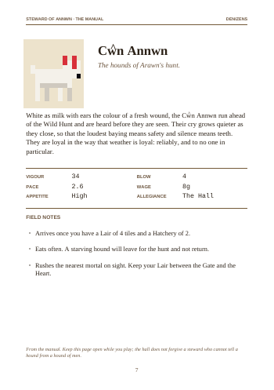
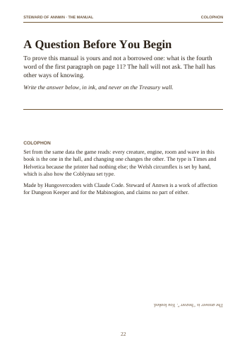
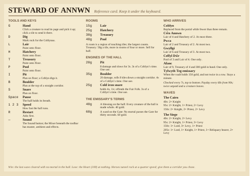
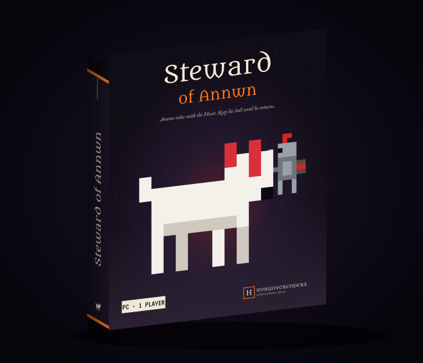

Games from the big-box era came with a manual you were expected to read, a reference card for under the keyboard, and a box with three screenshots and a quote from a magazine on the back. *Steward of Annwn* is a browser game that fits in a tab, but the manual is part of the design (the in-game panel is styled as a scanned page and the hall "does not forgive a steward who cannot tell a hound from a hound of men"), so the printed goods had to exist too. This post is about generating all of them from the game's own data with no PDF or image library, because the project rule from day one was no dependencies beyond Vite.



## Why not just use a library

Because the whole point of the exercise was that `task manual` reads the same `bestiary.ts`, `waves.ts` and `rooms.ts` the game reads and produces a booklet, and I wanted that to be a single Node script someone could read in one sitting. PDF is a simpler format than its reputation. A PDF file is a header, a list of numbered objects, a cross-reference table of their byte offsets, and a trailer pointing at the catalog. A page is an object. A page's content is another object containing a tiny postfix drawing language: `BT /F1 10.5 Tf 1 0 0 1 40 500 Tm (Hello) Tj ET` sets a font, moves to a point and shows a string. Rectangles and lines are `re` and `l` and `S`. That is nearly everything a text-and-rules manual needs.

The writer in `scripts/build-manual.mjs` is a class with `text()`, `line()`, `rect()`, a page counter and a `save()` that assembles objects, compresses each page's content stream with `node:zlib`, and writes the xref:

```js
const parts = [Buffer.from('%PDF-1.4\n%\xe2\xe3\xcf\xd3\n', 'latin1')];
// ... one object per font, page, content stream, plus /Pages and /Catalog ...
const xref = [`xref\n0 ${objects.length + 1}\n0000000000 65535 f \n`];
for (const off of offsets) xref.push(`${String(off).padStart(10, '0')} 00000 n \n`);
parts.push(Buffer.from(xref.join(''), 'latin1'));
parts.push(Buffer.from(
  `trailer\n<< /Size ${objects.length + 1} /Root ${catalogId} 0 R /Info ${infoId} 0 R >>\nstartxref\n${length}\n%%EOF\n`,
  'latin1',
));
```

The one thing a library would have done for me is fonts. Embedding a TrueType font means subsetting glyphs and writing a `FontDescriptor`, which is a weekend. PDF readers are required to carry fourteen standard fonts, though: Times, Helvetica and Courier in their four weights, plus Symbol and Zapf Dingbats. So the manual is set in Times with Helvetica Bold for the small caps headings and Courier for the stat numerals, and nothing is embedded. It looks like a manual printed in 1994 on whatever the printer had, which is accurate.

## Wrapping text without metrics

If you set text in a font you did not embed, you still have to know how wide each glyph is to wrap a paragraph, and the PDF does not tell you. The standard fonts have published AFM metrics; the script carries a table of advance widths in thousandths of an em for the letters and the punctuation that appears in the manual, typed in from the Adobe files, and falls back to a guess for anything else:

```js
const PUNCT_TIMES = { ' ': 250, '.': 250, ',': 250, ':': 278, '!': 333, '?': 444, '-': 333, '—': 1000, '’': 333, /* ... */ };
const METRICS = {
  F1: table(
    [444, 500, 444, 500, 444, 333, 500, 500, 278, 278, 500, 278, 778, 500, 500, 500, 500, 333, 389, 278, 500, 500, 722, 500, 500, 444],
    [722, 667, 667, 722, 611, 556, 722, 722, 333, 389, 722, 611, 889, 722, 722, 556, 722, 667, 556, 611, 722, 722, 944, 722, 722, 611],
    PUNCT_TIMES,
  ),
  // F2 Times-Italic, F3 Times-Bold, ...
};
```

Word wrapping is then the usual greedy loop: measure a word, add it to the line if it fits, else start a new line. The widths are close enough that nothing overflows a margin.

## The Ŵ problem

The game is set in Welsh myth and the hounds are the *Cŵn Annwn*. The standard fonts use WinAnsi encoding, and WinAnsi has no w-with-circumflex. There is no byte for it. You can write `?`, which is how most software handles Welsh, or you can cheat.

The cheat is in two halves. The encoder maps `ŵ` to a plain `w` so the word sets and measures correctly:

```js
else if (ch === 'ŵ') b = 'w'.charCodeAt(0);
else if (ch === 'Ŵ') b = 'W'.charCodeAt(0);
```

And `text()` walks the string a second time, adding up advance widths, and whenever it passes a `ŵ` it draws a separate, smaller `^` positioned over the centre of the `w` it just set:

```js
let dx = 0;
for (const ch of str) {
  const base = ch === 'ŵ' ? 'w' : ch === 'Ŵ' ? 'W' : ch;
  if (base !== ch) {
    const w = charWidth(base, font) * size;
    const hatSize = size * 0.8;
    const hx = x + dx + w / 2 - hatSize * 0.17;
    const hy = y + size * (base === 'W' ? 0.5 : 0.3);
    this.op(`BT /${font} ${hatSize} Tf ${rgb(color)} rg 1 0 0 1 ${hx.toFixed(2)} ${hy.toFixed(2)} Tm (^) Tj ET\n`);
  }
  dx += charWidth(base, font) * size;
}
```

This is exactly why the metrics table has to be right for `w`, because the hat lands wherever the arithmetic says the middle of the letter is. It is also, the colophon notes, how the Coblynau set type. The hat is a touch high on the capital and I have left it, because so was every circumflex in every Welsh book printed before 1990.

## The copy-protection page

Manuals of the period often doubled as copy protection: "What is the third word on page 11?" I wanted the joke, and I wanted it to be true, so the question is computed after the manual has been laid out. The Afanc page's number is recorded when its page is emitted; the script then splits the Afanc's flavour paragraph into words, picks the first substantial one after the opening pair so the answer is never "a", and writes the question with that ordinal and page number. In the current build it asks for the fourth word of the first paragraph on page 11, and the answer ("beaver") is printed upside down at the foot of the page with a 180-degree text matrix.



If the Afanc's paragraph changes, the question changes. If a page is added before it, the number changes. Nothing to maintain.

## The reference card

The same writer produces `dist/reference-card.pdf`: one A5 landscape page in four columns with the tools and keys, room costs, arrival rules, trap costs, the emissary's terms and the wave tables. It fell out of the manual in about forty lines because every table was already a function of the data.



## The box

The box went a different route, because a box is a picture and the PDF writer only draws rectangles and text. `scripts/build-box.mjs` writes three SVGs (front, back, spine) from the same sprite source the game uses, so the hounds on the front are the same sixteen-by-sixteen pixels as the hounds on the board, scaled up a few hundred times, in a cave mouth stepped out of the same size of pixel. SVG was the right format: it is text, it takes web fonts through an `@import`, it has gradients and filters (the grain is `feTurbulence`), and `foreignObject` lets the back-of-box paragraph wrap like HTML. Then, if Playwright's Chromium is present, the script opens each SVG at exactly 2250 by 2850 pixels (7.5 by 9.5 inches at 300 dpi), screenshots it to PNG, composes `box-3d.png` from the rendered faces with two skew matrices, and prints a PDF with one face per page at physical size.



Two things bit. An `&` in the Google Fonts URL inside the SVG `<style>` is an XML error, so the whole image rendered as a parser message until it became `&amp;`. And an SVG used as an `` cannot load external fonts, so the title screen's first attempt fell back to Times; the box script now also writes a 750-pixel PNG of the front for the title screen. CI skips the raster step and regenerates only the SVGs, which is fine because the SVGs are the source.

## What I would do again

All of it, with one change: I would write the PDF writer first, before the game had twelve creatures and nine pages of rules, because every piece of text I added to the bestiary afterwards was free in print, and knowing that changed how I wrote the game. The manual is not documentation of *Steward of Annwn*. It is the same data, set in Times, with a hat on the w.
